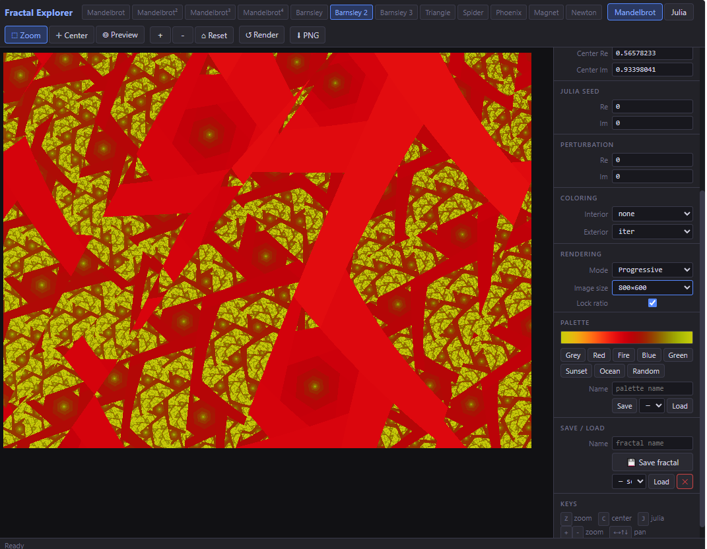

# Fractal Explorer

A web-based fractal explorer ported from a Java desktop application (2002).
Renders escape-time fractals in the browser using a Web Worker. It runs either
as a purely static site (e.g. GitHub Pages) or with a small optional
Python/Flask backend for saving and loading configurations on the server.



---

## Features

### Fractal formulas

| Name            | Description                                      |
| --------------- | ------------------------------------------------ |
| Mandelbrot      | Classic z² + c                                  |
| Mandelbrot 2–4 | Higher-degree variants (z³, z⁴, z⁵)           |
| Barnsley 1–3   | IFS-based fractals with conditional transforms   |
| Triangle        | Real/imaginary axis-swapped Mandelbrot variant   |
| Spider          | Self-modifying seed: c → c/2 + z each iteration |
| Phoenix         | Uses previous orbit value as additional term     |
| Magnet          | Complex division formula with two attractors     |
| Newton          | Newton's method root-finding on z³ − a         |

Each formula works in both **Mandelbrot** mode (c = pixel) and **Julia** mode
(c = fixed seed, z₀ = pixel). Newton always iterates from z₀ = pixel; in
Mandelbrot mode a = 1 + perturbation (classic z³ − 1), in Julia mode a = seed.

### Coloring

**Interior** (points that never escape):
`none` · `zmag` · `real/imag` · `color decomp.` · `squares`

**Exterior** (escape-time coloring):
`iter` · `iter+real` · `iter+imag` · `iter+real/imag` · `binary decomp.` · `color decomp.` · `potential`

### Palettes

Seven built-in presets (Greyscale, Red, Fire, Blue, Green, Sunset, Ocean), a
random generator, and save/load of custom palettes via the backend.

### Navigation

| Mode          | How to activate  | Action                                                             |
| ------------- | ---------------- | ------------------------------------------------------------------ |
| Pan (default) | `P` or toolbar | Drag to move the view; pinch to zoom on touch screens             |
| Zoom          | `Z` or toolbar | Drag a rectangle → click inside to zoom in, outside to zoom out   |
| Center        | `C` or toolbar | Click any point to re-center there                                 |
| Julia preview | `J` or toolbar | Hover over Mandelbrot view to see the corresponding Julia set live; click to open it |

In every mode the mouse wheel zooms around the cursor and right/middle-drag
pans. Additional controls: `+` / `-` zoom, arrow keys to pan, rotation and
zoom fields in the parameter panel.

### Display

The **Display** option (Rendering section) controls how the image fills the
canvas area: `1:1 pixels`, `Contain`, `Cover` (default), `Stretch`, or `Fill window`,
which renders at the area's own resolution (sharp, re-renders on resize).
`F` or the toolbar button toggles full screen. The choice is remembered in the
browser.

**Image size** offers presets from 200×200 up to 3840×2160 (square, 4:3 and
16:9), plus **Custom…** for any size up to 8192×8192.

### Rendering modes

- **Progressive** (default) — renders 16×16 blocks first, then refines to pixel level
- **Linear** — scans row by row, streaming updates to the canvas

Rendering runs in a Web Worker so the UI stays responsive. A new render
request automatically cancels the previous one.

---

## Getting started

### Static (no backend)

Serve the `static/` folder with any web server, e.g.

```bash
cd static
python -m http.server 8000
```

and open [http://localhost:8000](http://localhost:8000). Saved fractals and
palettes are kept in the browser's `localStorage`; use **Export JSON** /
**Import JSON** to move configs between browsers or machines. (Opening
`index.html` directly via `file://` does not work – browsers block Web
Workers there.)

### GitHub Pages

The workflow in `.github/workflows/pages.yml` publishes `static/` on every
push to `main`. Enable it once in the repository's
**Settings → Pages → Source: GitHub Actions**.

### With the Flask backend

**Requirements:** Python 3.9+

```bash
pip install -r requirements.txt
python app.py
```

Open [http://localhost:5000](http://localhost:5000) in your browser. Saved
configs are then stored as JSON files in `fractals/` and `palettes/`.

The app picks the storage automatically at startup: if `api/fractals` answers
with JSON it uses the server, otherwise the browser. The current choice is
shown as **Storage** in the side panel.

---

## Project layout

```
.
├── app.py              Flask REST backend (optional)
├── requirements.txt
├── fractals/           Saved fractal configs (created automatically)
├── palettes/           Saved custom palettes (created automatically)
└── static/
    ├── index.html
    ├── css/
    │   └── style.css
    └── js/
        ├── worker.js   Fractal math – formulas, coloring, renderer
        └── app.js      UI state, canvas interaction, storage (server / localStorage)
```

---

## REST API

Only used when running with the Flask backend. All data is stored as plain JSON files in `fractals/` and `palettes/`.

### Fractals

| Method     | Endpoint                 | Description                       |
| ---------- | ------------------------ | --------------------------------- |
| `GET`    | `/api/fractals`        | List saved fractal names          |
| `GET`    | `/api/fractals/<name>` | Load a fractal config             |
| `POST`   | `/api/fractals/<name>` | Save a fractal config (JSON body) |
| `DELETE` | `/api/fractals/<name>` | Delete a saved config             |

### Palettes

| Method     | Endpoint                 | Description                |
| ---------- | ------------------------ | -------------------------- |
| `GET`    | `/api/palettes`        | List saved palette names   |
| `GET`    | `/api/palettes/<name>` | Load a palette             |
| `POST`   | `/api/palettes/<name>` | Save a palette (JSON body) |
| `DELETE` | `/api/palettes/<name>` | Delete a palette           |

### Config format

Fractal configs are saved as standard JSON — a direct replacement for the
original `.fxc` text format:

```json
{
  "formula":      "Mandelbrot",
  "mode":         "mandelbrot",
  "origin":       [-0.5, 0.0],
  "zoom":         [1.0, 1.0],
  "rotation":     0.0,
  "perturbation": [0.0, 0.0],
  "julia_seed":   [-0.7, 0.27],
  "iterations":   120,
  "bailout":      4.0,
  "in_coloring":  "none",
  "out_coloring": "iter",
  "width":        512,
  "height":       512,
  "palette":      [[128,128,128], "...255 more entries..."]
}
```

Palette files contain just `{ "palette": [[r,g,b], ...] }`.

---

## Keyboard shortcuts

| Key                         | Action                       |
| --------------------------- | ---------------------------- |
| `P`                       | Switch to pan mode           |
| `Z`                       | Switch to zoom mode          |
| `C`                       | Switch to center mode        |
| `J`                       | Switch to Julia preview mode |
| `+` / `=`               | Zoom in                      |
| `-`                       | Zoom out                     |
| `←` `→` `↑` `↓` | Pan                          |
| `F`                       | Toggle full screen           |

---

## Origin

Originally written in Java (AWT) in 2002 by Miroslav Uller and Ondrej Kotik,
version 1.4. Rewritten as a browser app in 2026 — all fractal mathematics and
coloring algorithms are faithful ports of the original Java code.

---

## License

[MIT](LICENSE) © 2026
